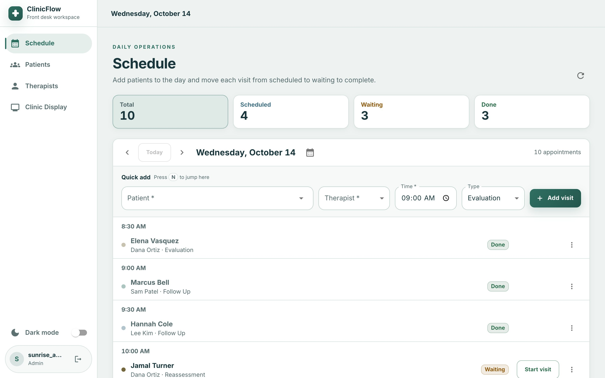
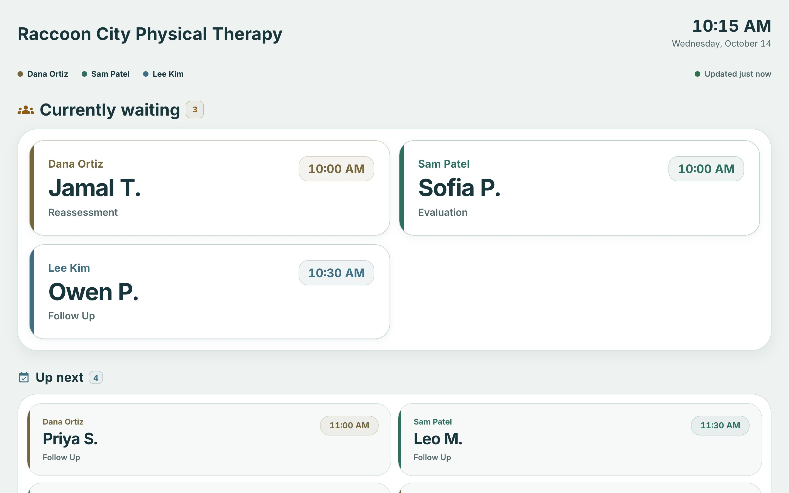
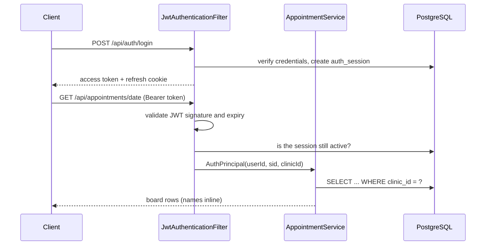

# ClinicFlow

Scheduling and check-in for physical therapy clinics. The front desk books the day and checks patients in, and a TV in the gym shows who is waiting and who is up next.

**Live demo:** [clinicflowappdemo.com](https://clinicflowappdemo.com). One click signs you in, no account needed.

| Front desk schedule | Clinic display board |
| --- | --- |
|  |  |

## Why I built it

ClinicFlow started at a physical therapy clinic where I worked. Every check-in meant someone walking back to the gym to tell a therapist their patient had arrived, and the schedule lived on a whiteboard. ClinicFlow replaces that with one shared system: the front desk updates it, and the board in the gym updates on its own.

## Features

**Front desk (`ADMIN`)**

- Today's schedule as an agenda grouped by time, with a fast-add row and patient typeahead
- One-click check-in through a simple lifecycle: `SCHEDULED → WAITING → DONE`
- Patient directory and therapist management
- Double-booking checks for both therapists and patients
- User management: admins create accounts and can disable or re-enable them

**Display board (`DISPLAY`)**

- Read-only TV view with **Currently Waiting** large and **Up Next** smaller
- Refreshes every 30 seconds and shows how long ago it last updated (turns amber if refreshes stop)
- Patients appear as first name and last initial, since the screen is public
- Therapist color legend, light and dark mode, and type that scales for 1080p and 4K screens

**Platform**

- Multi-tenant: every clinic's data is isolated by `clinic_id`
- JWT access tokens backed by server-side sessions, so a session can be revoked immediately
- Role-based access, checked by a test matrix that covers every route
- Read-only demo clinic that reseeds itself with visits around the current time

## Try the demo

The landing page has two buttons: **Front desk** signs in as the demo admin and **Display board** signs in as the display screen. The demo clinic is read-only except for check-in, so you can move patients through `SCHEDULED → WAITING → DONE` but not change other records.

The demo data resets nightly, and also on a demo admin login when it is more than 15 minutes old.

## Tech stack

| Backend | Frontend |
| --- | --- |
| Java 17, Spring Boot 3.5 | React 19, TypeScript, Vite 7 |
| Spring Security, JWT | MUI v7 and MUI X DataGrid |
| Spring Data JPA / Hibernate, MapStruct | TanStack Query |
| PostgreSQL, Flyway | React Router |
| JUnit 5, MockMvc, H2 | Vitest, Testing Library, MSW |

## Architecture

```
clinic-flow/
├── backend/              # Spring Boot API
└── client/clinicflow-ui/ # React / Vite frontend
```

The backend is organized by domain (`appointment`, `patient`, `therapist`, `users`, `auth`, `demo`, ...). Each domain has its own entity, repository, service, controller, MapStruct mapper and DTOs, and controllers never return entities directly.

The frontend has two surfaces, picked by the signed-in user's role: the front desk console for `ADMIN` and the display board for `DISPLAY`. All server data goes through TanStack Query hooks. Check-in updates the screen right away and rolls back if the request fails.

### Request flow



### Data model

Scheduling uses a flat model. An appointment links a patient and a therapist directly and carries `scheduledAt`, a `type` (`EVALUATION`, `REASSESSMENT`, `FOLLOW_UP`) and a `status`.

Core tables: `clinics`, `users`, `patients`, `therapists`, `appointments`, `auth_sessions`. Migrations live in `backend/src/main/resources/db/migration`.

### Multi-tenancy

- Every operational table has a `clinic_id` column.
- The authenticated principal carries the user's `clinicId`.
- Services pass it to clinic-scoped repository methods such as `findByIdAndClinicId(...)`, so a record from another clinic returns 404.

### Authentication and security

- Login returns a short-lived access token (Bearer JWT) and sets a refresh token in an HTTP-only cookie.
- Each login creates an `auth_sessions` row. A request is accepted only if its JWT is valid **and** its session is still active, so logout and disabling a user take effect immediately.
- The frontend retries a 401 once with the refresh cookie before signing the user out.
- There is no public sign-up. Admins create accounts in their own clinic.
- Disabled users are rejected at login and refresh with the same 401 as a wrong password, so the response doesn't reveal which accounts exist.
- `config/SecurityRulesTest` runs the real security filters against every route for anonymous, `DISPLAY` and `ADMIN` callers. It fails if a new route has no rule.

## API overview

| Endpoint | Access |
| --- | --- |
| `POST /api/auth/login` | Public |
| `POST /api/auth/demo/{ADMIN\|DISPLAY}` | Public |
| `POST /api/auth/refresh` | Public (refresh cookie) |
| `GET /api/auth/me`, `POST /api/auth/logout` | Signed in |
| `GET /api/appointments/date?date=` | Signed in (defaults to today) |
| `POST /api/appointments`, `PATCH /api/appointments/{id}`, `DELETE /api/appointments/{id}` | Admin |
| `GET /api/patients`, `GET /api/patients/search?q=`, `POST`, `PATCH`, `DELETE` | Admin |
| `GET /api/therapists`, `POST`, `DELETE` | Admin |
| `GET /api/users`, `POST /api/users`, `PATCH /api/users/{id}` (role, enabled) | Admin |

The daily board returns denormalized rows with patient and therapist names inline:

```json
[
  {
    "id": 5,
    "scheduledAt": "2026-02-23T10:00",
    "type": "EVALUATION",
    "status": "SCHEDULED",
    "patientId": 8,
    "patientName": "Leon Kennedy",
    "therapistId": 2,
    "therapistName": "Ada Wong"
  }
]
```

## Running locally

### Prerequisites

- Java 17
- Node.js 20.19+ or 22.12+
- PostgreSQL 16 (or Docker)

### Backend

Create `backend/.env` (loaded automatically):

```
DB_URL=jdbc:postgresql://localhost:5432/clinicflow
DB_USER=postgres
DB_PASSWORD=postgres
JWT_SECRET=change-me-to-a-long-random-secret
```

Then start the API on `http://localhost:8080`. Flyway creates the schema and seeds the demo clinic on first run.

```bash
cd backend && ./mvnw spring-boot:run
```

Or run PostgreSQL and the backend together with Docker:

```bash
cd backend && docker compose up --build
```

### Frontend

```bash
cd client/clinicflow-ui && npm install && npm run dev
```

The app runs on `http://localhost:5173` and proxies `/api` to the backend on port 8080. To point it at a different backend, set `VITE_API_PROXY_TARGET` in `client/clinicflow-ui/.env.local`.

## Testing

Backend tests run against an in-memory H2 database, so no setup is needed:

```bash
cd backend && ./mvnw test
```

Frontend tests use Vitest with MSW mocking the API:

```bash
cd client/clinicflow-ui && npm run test:run
```

Formatting: Spotless for the backend (`./mvnw spotless:apply`) and Prettier for the frontend.

## Deployment

- **Frontend:** Render static site, served at [clinicflowappdemo.com](https://clinicflowappdemo.com)
- **Backend:** Docker container on EC2, with PostgreSQL on the same instance
- **TLS:** Caddy terminates TLS for `api.clinicflowappdemo.com`

## Roadmap

- Users page in the admin console (the API already supports creating, disabling and re-enabling users)
- Invite-only sign-up, so new staff can set their own password
- Guard against an admin demoting themselves or the last admin
